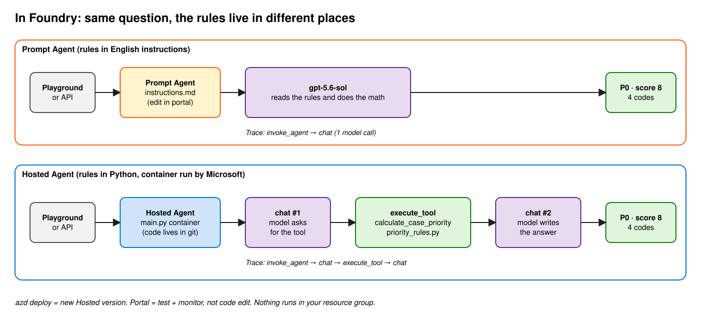
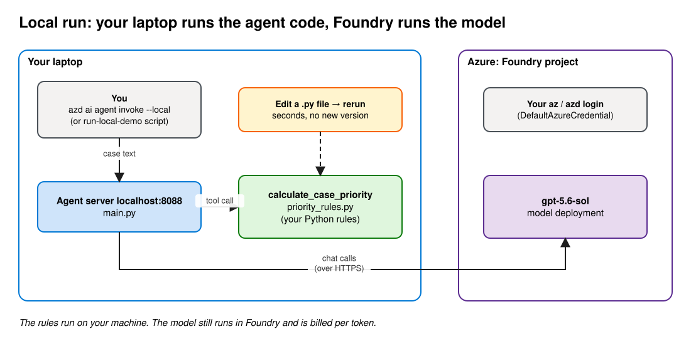

# Prompt Agent vs Hosted Agent in Microsoft Foundry

One fictional support case goes to two agents. Both answer **P0, score 8**. The difference is **where the rules live and who owns them**.

> Unsupported demo. Contoso and the scoring rules are fictional, not Microsoft policy.

## The case

```text
Contoso Retail · $240,000 contract · 95-minute outage · 2 regulated regions · renewal in 21 days
```

| Rule | Points | Reason code |
|---|---|---|
| Outage ≥ 60 min | 3 | `OUTAGE_60` |
| Contract ≥ $200,000 | 2 | `STRATEGIC_CONTRACT` |
| ≥ 1 regulated region | 2 | `REGULATED_IMPACT` |
| Renewal ≤ 30 days | 1 | `RENEWAL_30` |

Score 7+ = P0 · 4–6 = P1 · 2–3 = P2 · 0–1 = P3.

## How it works in Foundry



| | Prompt Agent | Hosted Agent |
|---|---|---|
| Rules live in | [`instructions.md`](prompt_agent/instructions.md) (English) | [`priority_rules.py`](deployment/src/agent-framework-agent-with-local-tools-responses/priority_rules.py) (Python) |
| Math done by | the model | your code, as a tool the model calls |
| Change it by | editing instructions in the portal | edit code → test → `azd deploy` |
| Each change makes | a new agent version | a new agent version (new container) |
| Trace shows | `chat` | `chat → execute_tool → chat` |
| Best when | rules are guidance and change often | rules must be exact, tested, auditable |

The Hosted Agent's container runs on Microsoft-managed compute. Your resource group holds only the Foundry account, project, model deployment, and (optionally) monitoring.

## How it works locally



`azd ai agent run` starts the Hosted Agent code on `localhost:8088`. The Python rules run on your laptop, but every model call still goes to the `gpt-5.6-sol` deployment in your Foundry project. Edit a `.py` file, rerun, see the change in seconds. No new version is created.

## Deploy with AI

Open this repo in your AI coding agent (GitHub Copilot, Claude Code, …) and prompt:

```text
Follow ai-deployment.md to deploy this demo to my Azure subscription.
Tenant: <TENANT_ID>  Subscription: <SUBSCRIPTION_ID>  Resource group: <RESOURCE_GROUP>
```

The agent asks you to sign in, provisions everything (including Application Insights for traces), and tests both agents.

## Docs

| File | For | What |
|---|---|---|
| [ai-deployment.md](ai-deployment.md) | AI agent (or you) | Exact deployment steps, Windows + macOS/Linux, tracing, cleanup |
| [customer-demo-local.md](customer-demo-local.md) | Presenter | Run the Hosted Agent locally and change one rule |
| [customer-demo.md](customer-demo.md) | Presenter | Prompt the deployed Hosted Agent in the portal and read its trace |
| [docs/original-README.md](docs/original-README.md) | Reference | Upstream setup guide (macOS/Linux) |
| [docs/original-CUSTOMER_DEMO.md](docs/original-CUSTOMER_DEMO.md) | Reference | Upstream seven-minute presentation script |
| [VALIDATED_OUTPUT.md](VALIDATED_OUTPUT.md) | Fallback | Known-good output if a live call fails |

Diagrams are in [docs/diagrams](docs/diagrams). Edit the `.excalidraw` files at <https://excalidraw.com> or the Excalidraw VS Code extension.

## Cost

Model calls, Hosted Agent sessions, and trace ingestion are billed. Delete the resource group when done (see [ai-deployment.md § Clean up](ai-deployment.md#15-clean-up)).

## License

MIT. Hosted Agent scaffold adapted from [microsoft-foundry/foundry-samples](https://github.com/microsoft-foundry/foundry-samples/tree/main/samples/python/hosted-agents/agent-framework/responses/02-tools). See [LICENSE](LICENSE).
