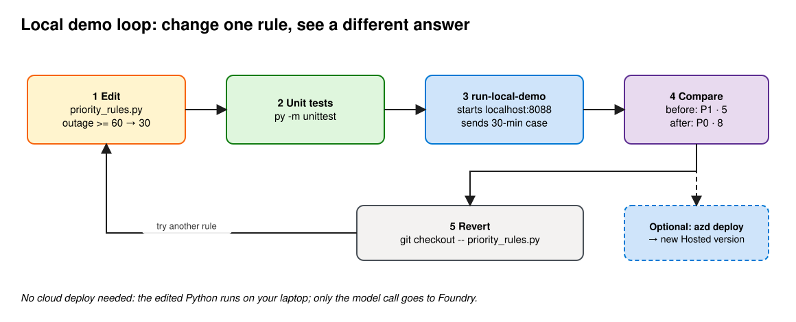

# Customer demo: run locally and change a rule

Show that the Hosted Agent's decision comes from code you own: change one line, get a different priority.



**Before you start:** complete [ai-deployment.md](ai-deployment.md) steps 1–10. You need both `.env` files and the Hosted Agent `.venv`. No cloud deploy is needed for this demo.

## 1. Baseline: 95-minute outage

```powershell
./scripts/run-local-demo.ps1                     # Windows
```

```bash
bash scripts/run-local-demo.sh                   # macOS/Linux
```

Expect **P0 · score 8** · `OUTAGE_60` `STRATEGIC_CONTRACT` `REGULATED_IMPACT` `RENEWAL_30` · `Python tool calls: 1`.

The script starts the agent on `localhost:8088`, sends the case, and stops the server.

## 2. Shorter outage: 30 minutes

```powershell
./scripts/run-local-demo.ps1 -OutageMinutes 30
```

```bash
bash scripts/run-local-demo.sh 30
```

Expect **P1 · score 5** · `STRATEGIC_CONTRACT` `REGULATED_IMPACT` `RENEWAL_30`. No `OUTAGE_60`: 30 is under the 60-minute rule.

## 3. Change the rule: 60 → 30 minutes

In [`priority_rules.py`](deployment/src/agent-framework-agent-with-local-tools-responses/priority_rules.py):

```diff
-    if outage_minutes >= 60:
+    if outage_minutes >= 30:
         score += 3
         reason_codes.append("OUTAGE_60")
```

Or from the terminal:

```powershell
$f = 'deployment\src\agent-framework-agent-with-local-tools-responses\priority_rules.py'
(Get-Content $f -Raw).Replace('outage_minutes >= 60', 'outage_minutes >= 30') | Set-Content $f -NoNewline
```

```bash
perl -pi -e 's/outage_minutes >= 60/outage_minutes >= 30/' \
  deployment/src/agent-framework-agent-with-local-tools-responses/priority_rules.py
```

Run the tests, then the same 30-minute case again:

```bash
py -3.13 -m unittest discover -s deployment/src/agent-framework-agent-with-local-tools-responses/tests     # Windows
python3.13 -m unittest discover -s deployment/src/agent-framework-agent-with-local-tools-responses/tests   # macOS/Linux
```

```powershell
./scripts/run-local-demo.ps1 -OutageMinutes 30        # or: bash scripts/run-local-demo.sh 30
```

Now expect **P0 · score 8**, and `OUTAGE_60` is back.

Notes:

- The 4 existing tests still pass. None of them use an outage between 30 and 59 minutes. In a real change, add a test for the new threshold first. That's the point of keeping rules in code.
- The reason code is still called `OUTAGE_60`. Rename it if you keep the change.
- The prompt and the model didn't change. Only your Python did.
- If tracing is connected ([ai-deployment.md](ai-deployment.md) step 12), local runs also send traces to App Insights, because `azd ai agent run` passes `APPLICATIONINSIGHTS_CONNECTION_STRING` from the azd env. The `execute_tool` span shows `outage_minutes: 30` → P0 locally, next to the cloud's P1.

## 4. Revert

```bash
git checkout -- deployment/src/agent-framework-agent-with-local-tools-responses/priority_rules.py
```

## Optional: ship it

To put the changed rule in the cloud, run `azd deploy field-demo-support-triage-hosted --no-prompt` from `deployment/`. It creates a new Hosted Agent version (see [customer-demo.md](customer-demo.md#5-find-the-versions)). Revert and redeploy afterwards if this was only a demo.

## What to say

- "The rule is a Python function with unit tests. The model calls it. It doesn't do the math."
- "I changed one line and the priority changed. The prompt and model stayed the same."
- "With a Prompt Agent, you'd change the English instructions instead, and the model applies them."
