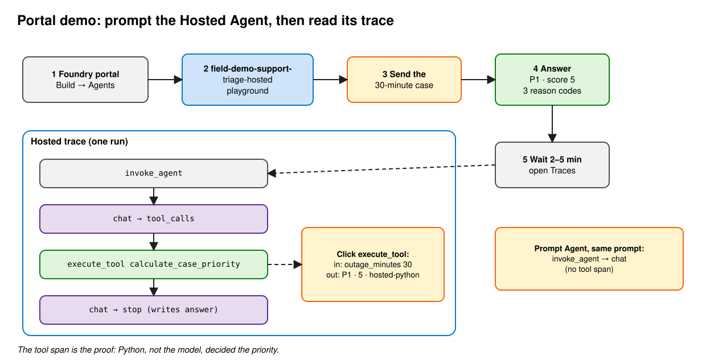

# Customer demo: prompt the Hosted Agent and read its trace

Show the deployed Hosted Agent in the Foundry portal, then prove from its trace that Python, not the model, set the priority.



**Before you start:** complete [ai-deployment.md](ai-deployment.md), including step 12 (tracing). Get the agent links from step 13 or the `azd deploy` output.

> Portal labels change. If a name below doesn't match exactly, look for the closest equivalent.

## 1. Open the Hosted Agent

[Foundry portal](https://ai.azure.com) → your project → **Build → Agents** → `field-demo-support-triage-hosted`. The agent page opens with a chat playground.

You can test it here, but you can't edit its code here. The code lives in this repo.

## 2. Send the 30-minute case

```text
Triage this support case. Customer: Contoso Retail. Annual contract: $240,000. Production outage: 30 minutes. Regulated regions affected: 2. Renewal in: 21 days. Summarize the priority, reason codes, first response, and next three actions.
```

Expect **P1 · score 5** · `STRATEGIC_CONTRACT` `REGULATED_IMPACT` `RENEWAL_30`. No `OUTAGE_60`.

The first message can take ~7 s while a session container starts.

## 3. Read the trace

Wait 2–5 minutes for ingestion. On the agent page, look for the **Traces** tab (also under **Agents → Traces** for the whole project). Open the newest trace and expand it:

```text
invoke_agent
├─ chat                 model reads the case, asks for the tool   (finish: tool_calls)
├─ execute_tool calculate_case_priority          ← your Python
└─ chat                 model writes the answer                   (finish: stop)
```

Click **execute_tool calculate_case_priority**:

| | Value |
|---|---|
| Input | `{"annual_contract_usd": 240000, "outage_minutes": 30, "regulated_regions": 2, "renewal_days": 21}` |
| Output | `{"priority": "P1", "score": 5, "reason_codes": [...], "rule_source": "hosted-python", ...}` |
| Duration | ~2 ms |

Click the second **chat** span. The model received the tool result and copied P1 / 5 into the answer.

You may also see `POST …/openai/v1/responses` spans (the HTTP calls to the model) and server-side `invoke_agent` / `chat` spans. They're the same calls seen from the platform side.

## 4. Bonus: same prompt on the Prompt Agent

Open `field-demo-support-triage-prompt` and send the same text. Expect the same **P1 · 5**.

Its trace has **no tool span**: `invoke_agent → chat`. The model applied the English rules in [`instructions.md`](prompt_agent/instructions.md) by itself.

## 5. Find the versions

Every `azd deploy` creates a new Hosted Agent version. Every saved change to a Prompt Agent creates a new Prompt Agent version.

- Portal: look for the version selector on the agent page. Links can pin one with `?version=N`.
- CLI: `azd ai agent show field-demo-support-triage-hosted --output json` (from `deployment/`) shows `version` and `status`.

## 6. Same data in KQL

Azure portal → the App Insights resource → **Logs**:

```kql
dependencies
| where timestamp > ago(1h)
| where customDimensions["gen_ai.operation.name"] == "execute_tool"
| project timestamp, operation_Id,
    tool   = tostring(customDimensions["gen_ai.tool.name"]),
    input  = tostring(customDimensions["gen_ai.tool.call.arguments"]),
    output = tostring(customDimensions["gen_ai.tool.call.result"])
| order by timestamp desc
```

Full span list for one run (paste an `operation_Id` from above):

```kql
union requests, dependencies
| where operation_Id == "<operation_Id>"
| project timestamp, cloud_RoleName, name, duration,
    tokens_in  = toint(customDimensions["gen_ai.usage.input_tokens"]),
    tokens_out = toint(customDimensions["gen_ai.usage.output_tokens"])
| order by timestamp asc
```

## What to say

- "The playground is the same for both agents. The difference shows up in the trace."
- "This span is our Python function. Input in, priority out, 2 ms, no model involved."
- "To change this rule we change code, test it, and deploy a new version. The portal is for testing and monitoring."

For the full seven-minute talk track, see [docs/original-CUSTOMER_DEMO.md](docs/original-CUSTOMER_DEMO.md). To change the rule live, see [customer-demo-local.md](customer-demo-local.md).
